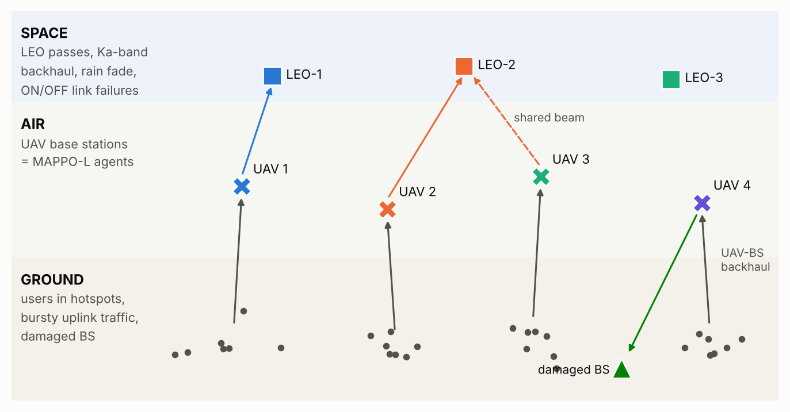

# uav-satellite-marl-6g
Reliability-aware multi-agent PPO (MAPPO) for joint UAV trajectory, user association, power allocation, and satellite-backhaul selection in disaster-resilient 6G space-air-ground networks. Optimizes under outage, PDR, and AoI constraints.

<!-- RESULTS_SUMMARY -->



## What is implemented

| Research step | Implementation |
| --- | --- |
| **1. Heterogeneous space–air–ground model** with stochastic link failures and time-varying traffic | `sagin/env.py`: vectorised simulator. 4 UAV base stations, 40 ground users in disaster hotspots, 3 LEO satellite passes (spherical-Earth geometry), and one damaged terrestrial BS. Probabilistic-LoS air-to-ground channels with blockage memory, directional UAV antennas and co-channel interference. Ka-band link budget with Weibull rain fade, Gilbert–Elliott ON/OFF link failures, gateway failures, bursty (Markov-modulated Poisson) traffic, and age-indexed two-hop queues with packet deadlines. |
| **2. Reliability constraints** on outage probability, packet delivery ratio (PDR) and age of information (AoI) | The environment returns 3 per-slot costs, shifted by their thresholds. Their episode averages are ≤ 0 exactly when P_out ≤ 0.10, PDR ≥ 0.80 and mean AoI ≤ 12 slots (checked in `tests/`). |
| **3. Joint trajectory, association, power and backhaul selection** as a constrained decentralised problem | A constrained Dec-POMDP. Each UAV observes only local information and chooses a hybrid action: 3-D velocity, an ordered assignment of its 4 resource blocks to nearby users (or idle), each scheduled user's transmit power, a backhaul choice {hold, LEO-1..3, gateway} with feasibility masking, and its backhaul power. |
| **4. MAPPO with centralised training and decentralised execution** | `marl/`: MAPPO-Lagrangian with a pointer-network actor shared by all UAVs. A centralised DeepSets critic has one reward head per UAV and one head per constraint. Lagrange multipliers follow PI-controlled dual ascent. Baselines: unconstrained MAPPO, fixed-penalty MAPPO, IPPO-Lagrangian and 3 heuristics. |

The full system model, problem formulation (P1), constrained Markov-game formulation, algorithm and results are in **[docs/REPORT.md](docs/REPORT.md)**.

## Repository layout

```
sagin/                      simulator
  config.py                 every system / training parameter (dataclasses)
  env.py                    vectorised SAGIN disaster environment (channels, orbits, failures, queues, AoI)
  baselines.py              Random, Static-KMeans and Greedy-Track heuristics; run_policy()
marl/                       learning
  networks.py               pointer-network hybrid actor, centralised DeepSets critic, local critic
  mappo.py                  MAPPO-Lagrangian trainer (mappo_l | mappo | mappo_pen | ippo_l), validation, checkpoints
  pretrain.py               behaviour-cloning warm start of the shared actor
scripts/
  train.py                  train one method / seed (any config field can be overridden on the command line)
  run_experiments.sh        every training run of the report (~2.5 h on 2 CPU cores)
  evaluate.py               main comparison, severity sweep, load sweep, recorded episodes
  summarize.py              CSV -> Markdown tables (results/tables.md)
  make_figures.py           all figures in results/figures/
  param_table.py            parameter tables of the report, generated from sagin/config.py
  build_report_pdf.sh       docs/REPORT.md -> docs/REPORT.pdf (pandoc + xelatex)
tests/test_core.py          sanity tests (packet conservation, cost identities, log-prob consistency, ...)
docs/REPORT.md, REPORT.pdf  technical report
results/                    evaluation tables (CSV, tables.md) and figures
```

## Quick start

```bash
python -m venv .venv && source .venv/bin/activate
pip install -r requirements.txt            # torch CPU build is enough
python -m pytest -q tests                  # ~10 s
```

Train one policy:

```bash
python -m marl.pretrain --out checkpoints/bc_actor.pt                 # 2 min warm start
python scripts/train.py --algo mappo_l --seed 0 --iters 300 \
       --algo-cfg init_actor=checkpoints/bc_actor.pt critic_warmup=5   # ~25 min on one CPU core
```

Any field of `EnvConfig` or `AlgoConfig` can be overridden from the command line, for example:

```bash
python scripts/train.py --algo mappo_l --env eps_out=0.05 n_uav=6 --algo-cfg lr_actor=1e-4 n_envs=32
```

Reproduce every number and figure of the report:

```bash
bash scripts/run_experiments.sh             # trains all methods (logs in runs/, checkpoints in checkpoints/)
python scripts/evaluate.py --episodes 128 --sweep-episodes 32 \
  --method "MAPPO-L (proposed)=checkpoints/mappo_l_s0/final.pt,checkpoints/mappo_l_s1/final.pt,checkpoints/mappo_l_s2/final.pt" \
  --method "MAPPO-L, 600 iterations=checkpoints/mappo_l_long_s0/final.pt,checkpoints/mappo_l_long_s1/final.pt" \
  --method "MAPPO=checkpoints/mappo_s0/final.pt" \
  --method "MAPPO-Pen=checkpoints/mappo_pen_s0/final.pt" \
  --method "IPPO-L=checkpoints/ippo_l_s0/final.pt" \
  --method "MAPPO-L, no safety margin=checkpoints/mappo_l_nomargin_s0/final.pt" \
  --method "MAPPO-L, no warm start=checkpoints/mappo_l_scratch_s0/final.pt" \
  --sweep-only "MAPPO-L (proposed)" MAPPO MAPPO-Pen IPPO-L Greedy-Track Static-KMeans
python scripts/summarize.py
python scripts/make_figures.py
bash scripts/build_report_pdf.sh
```

`runs/` and `checkpoints/` are git-ignored, as is the rule in `.gitignore`; only the CSV tables and `results/figures/` are meant to be committed.

<!-- RESULTS_SECTION -->

## Design notes

* **Why a Lagrangian rather than reward shaping?** The three reliability targets are hard requirements with units, such as "≤ 10 % outage". Fixed penalty weights either over- or under-shoot them, and the right weights change with the disaster severity. The multipliers adapt online: each rises while its constraint is violated and decays once it holds.
* **Why CTDE?** At run time a UAV only sees its neighbourhood, its own buffer, broadcast satellite ephemerides and a coarse demand map. During training the critic sees the global state, including the true link-failure states and traffic regimes, which reduces the variance of the advantage estimates for every agent.
* **Why a behaviour-cloning warm start?** From scratch, MAPPO learns steadily but slowly on this problem (≈ 45 % PDR after 1.3 × 10⁵ environment steps). The actor is therefore initialised by imitating the centralised Greedy-Track heuristic from local observations only, which takes about 2 minutes. All learned methods share this initialisation, and a from-scratch run is reported as an ablation.
* **Fluid packet model.** Queues are age-indexed fluid buffers (FIFO, deadline drop), so PDR and AoI come out of the dynamics instead of being approximated in the reward.

## References

1. G. K. Pandey, D. S. Gurjar, S. Yadav, R. Gour, J. Gazda, "Dual UAV-assisted secure IoT networks: Resource allocation and 3D trajectory design," *IEEE Trans. Veh. Technol.*, 2025, doi:10.1109/TVT.2025.3611962.
2. G. K. Pandey, D. S. Gurjar, S. Yadav, G. Prasad, J. Gazda, "Resource allocation and robust trajectory design for dual UAV-assisted secure communications," *IEEE Trans. Veh. Technol.*, 2025, doi:10.1109/TVT.2025.3608080.
3. G. Zhang, X. Wei, X. Tan, Z. Han, G. Zhang, "AoI minimization based on deep reinforcement learning and matching game for IoT information collection in SAGIN," *IEEE Trans. Commun.*, 2025, doi:10.1109/TCOMM.2025.3525566.
4. W. Zhao *et al.*, "A survey on DRL-based UAV communications and networking: DRL fundamentals, applications and implementations," *IEEE Commun. Surveys Tuts.*, vol. 28, 2026.
5. N. González-Prelcic *et al.*, "The integrated sensing and communication revolution for 6G: Vision, techniques, and applications," *Proc. IEEE*, vol. 112, no. 7, pp. 676–723, Jul. 2024.
6. C. Yu *et al.*, "The surprising effectiveness of PPO in cooperative multi-agent games," *NeurIPS Datasets and Benchmarks*, 2022.
7. J. Schulman *et al.*, "Proximal policy optimization algorithms," arXiv:1707.06347, 2017.
8. S. Gu *et al.*, "Multi-agent constrained policy optimisation," arXiv:2110.02793, 2021.
9. A. Stooke, J. Achiam, P. Abbeel, "Responsive safety in reinforcement learning by PID Lagrangian methods," *ICML*, 2020.
10. A. Al-Hourani, S. Kandeepan, S. Lardner, "Optimal LAP altitude for maximum coverage," *IEEE Wireless Commun. Lett.*, vol. 3, no. 6, 2014.
11. Y. Zeng, J. Xu, R. Zhang, "Energy minimization for wireless communication with rotary-wing UAV," *IEEE Trans. Wireless Commun.*, vol. 18, no. 4, 2019.
12. S. Kaul, R. Yates, M. Gruteser, "Real-time status: How often should one update?" *IEEE INFOCOM*, 2012.
13. 3GPP TR 38.811, "Study on New Radio (NR) to support non-terrestrial networks"; 3GPP TR 38.901 (antenna pattern).
