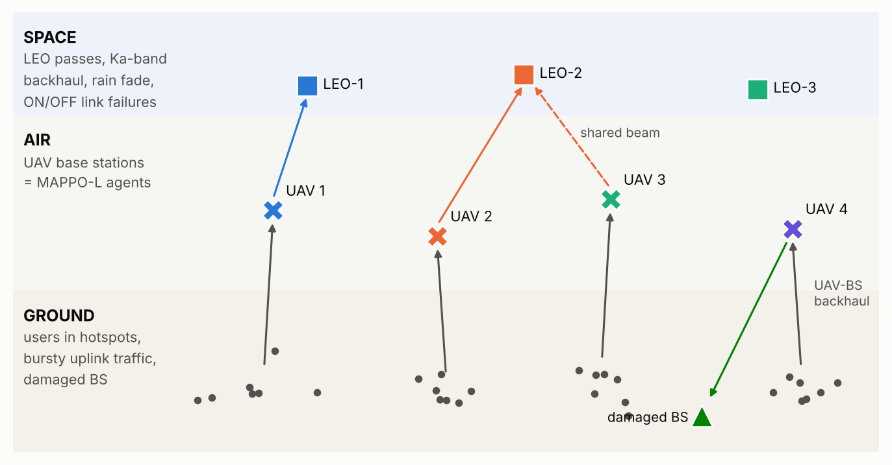

# 1. Overview

After an earthquake or flood the terrestrial cellular network of the affected area is mostly destroyed. A fleet of UAV aerial base stations is dispatched to collect time-critical uplink status traffic (SOS messages, vital signs, structural-health sensors, responder video) and forward it to the emergency control centre over **LEO satellite backhaul** or over the residual capacity of a **damaged terrestrial base station**. Links fail at random, satellites rise and set, and traffic surges when new incidents occur. The operator does not only want throughput: it needs **reliability guarantees** on outage, packet delivery and information freshness.

The project follows the proposed research flow:

| Research step | Where it is realised |
| --- | --- |
| 1. Heterogeneous space–air–ground model with stochastic link failures and time-varying traffic | Section 2, `sagin/env.py` |
| 2. Reliability constraints: outage probability, packet delivery ratio (PDR), age of information (AoI) | Section 3 |
| 3. Joint trajectory, user association, power allocation and satellite-backhaul selection as a constrained decentralised decision problem | Section 4 (problem P1 and constrained Dec-POMDP) |
| 4. Multi-agent PPO with centralised training and decentralised execution (CTDE) | Section 5, `marl/` (MAPPO-Lagrangian) |

**Contributions.**

1. A vectorised simulator of a disaster-area SAGIN: probabilistic-LoS air-to-ground channels with blockage memory and directional UAV antennas; co-channel interference under full frequency reuse; LEO passes computed from spherical-Earth geometry; Ka-band link budget with Weibull rain fade and Gilbert–Elliott ON/OFF link failures; a failure-prone terrestrial gateway; Markov-modulated bursty traffic; and age-indexed two-hop queues with deadlines, so that outage, PDR and AoI are measured rather than assumed.
2. A formulation of the joint problem as a constrained Markov game whose per-slot costs are shifted by their thresholds, so that the three reliability requirements become expected-cost constraints of the form $J_{C_i}\le 0$. The shifted costs are exact: the time-average of the outage and PDR costs is non-positive if and only if the pooled outage probability and PDR meet their targets.
3. **MAPPO-Lagrangian** with a hybrid pointer-network actor (continuous 3-D motion, Plackett–Luce resource-block scheduling with an idle option, per-user power, categorical backhaul selection with feasibility masking, backhaul power) shared by all UAVs, a centralised DeepSets critic with one reward head per agent and one head per constraint, and PI-controlled dual ascent on the Lagrange multipliers.
4. A comparison against unconstrained MAPPO, fixed-penalty MAPPO, IPPO-Lagrangian (decentralised critics) and three heuristics, plus robustness sweeps over disaster severity and traffic load.

# 2. System model



Time is slotted, $t\in\{1,\dots,T\}$, with slot length $\tau$. Within a slot, positions, blockage states and fading are constant (block fading).

## 2.1 Network entities

* **Ground users** $\mathcal K=\{1,\dots,K\}$ at positions $\mathbf w_k[t]\in[0,L]^2$, grouped in $C$ hotspots (Gaussian clusters), plus scattered users. A fraction of the users (responders) move with a correlated random-walk model.
* **UAVs** $\mathcal U=\{1,\dots,U\}$ at horizontal position $\mathbf q_u[t]$ and altitude $h_u[t]$. Each UAV owns $N_{\mathrm{RB}}$ resource blocks (RBs) of bandwidth $B_{\mathrm{RB}}$; the spectrum is reused by every UAV.
* **LEO satellites** $\mathcal S=\{1,\dots,S\}$ at altitude $H$, each on its own pass over the area.
* **A damaged terrestrial base station** (gateway $g$) at $\mathbf w_g$ with a residual fronthaul capacity $C_g$, reachable within a horizontal range $R_g$.

## 2.2 UAV mobility and energy

With velocity commands $(\mathbf v_u[t],v^z_u[t])$:

$$
\mathbf q_u[t+1]=\Pi_{[0,L]^2}\!\big(\mathbf q_u[t]+\mathbf v_u[t]\tau\big),\qquad
h_u[t+1]=\Pi_{[h_{\min},h_{\max}]}\!\big(h_u[t]+v^z_u[t]\tau\big),
$$

$$
\|\mathbf v_u[t]\|\le v_{\max},\qquad |v^z_u[t]|\le v^z_{\max},\qquad
\big\|(\mathbf q_u,h_u)-(\mathbf q_{u'},h_{u'})\big\|\ge d_{\min}\ \ \forall u\neq u'.
$$

The collision constraint is enforced by a safety layer: a move that would violate $d_{\min}$ is cancelled and penalised in the reward. The propulsion power of a rotary-wing UAV at speed $V=\|\mathbf v_u\|$ is (Zeng *et al.*, TWC 2019), plus a climbing term:

$$
P^{\mathrm{prop}}(V,v^z)=P_0\Big(1+\tfrac{3V^2}{U_{\mathrm{tip}}^2}\Big)+P_i\Big(\sqrt{1+\tfrac{V^4}{4v_0^4}}-\tfrac{V^2}{2v_0^2}\Big)^{1/2}+\tfrac12 d_0\rho sAV^3+W\max(v^z,0).
$$

It equals 168.5 W in hover, has a minimum of about 126 W at 10 m/s, and reaches 249 W at 25 m/s.

## 2.3 Access link (user → UAV, uplink)

For user $k$ and UAV $u$, let $r_{uk}$ be the horizontal distance, $d_{uk}=\sqrt{r_{uk}^2+h_u^2}$ the 3-D distance and $\theta_{uk}=\arctan(h_u/r_{uk})$ the elevation angle in degrees.

**Probabilistic LoS with blockage memory.** The LoS probability follows Al-Hourani *et al.*:

$$
P^{\mathrm{LoS}}_{uk}=\frac{1}{1+a\exp\!\big(-b(\theta_{uk}-a)\big)}.
$$

The blockage state $\ell_{uk}[t]\in\{0,1\}$ is temporally correlated: with probability $\rho_\ell$ it keeps its previous value, otherwise it is redrawn from $\mathrm{Bernoulli}(P^{\mathrm{LoS}}_{uk})$. Collapsed buildings add an NLoS excess loss that grows with the disaster severity $\sigma\in[0,1]$.

**Directional UAV antenna.** The receive antenna points to nadir with a 3GPP-style pattern:

$$
G(\theta)=G_{\max}-\min\big\{12\,((90^\circ-\theta)/\phi_{3\mathrm{dB}})^2,\ \mathrm{SLA}\big\}\ \ [\mathrm{dB}].
$$

**Path loss and fading.** The channel power gain is $g_{uk}[t]=10^{-\mathrm{PL}_{uk}/10}|h_{uk}|^2$, where

$$
\mathrm{PL}_{uk}=\mathrm{FSPL}(d_{uk},f_c)-G(\theta_{uk})+
\begin{cases}\eta_{\mathrm{LoS}}, & \ell_{uk}=1\\ \eta_{\mathrm{NLoS}}+\Delta\eta\,\sigma, & \ell_{uk}=0\end{cases}
$$

and $|h_{uk}|^2$ is Rician with factor $K$ in LoS and exponential (Rayleigh) in NLoS.

**User association and RB assignment.** The binary variable $a_{u,k,c}[t]$ is 1 if UAV $u$ schedules user $k$ on RB $c$, subject to

$$
\sum_k a_{u,k,c}\le 1,\qquad \sum_c a_{u,k,c}\le 1,\qquad \sum_u\sum_c a_{u,k,c}\le 1.
$$

The last constraint says a user is associated with at most one UAV per slot. When two UAVs claim the same user, the user associates with the claimant of the strongest average channel and the other RB stays idle. Such conflicts are counted as a coordination failure.

**SINR, rate and outage.** User $k$ is served by $u$ on RB $c$ with power $p_{k,c}\in[p_{\min},p_{\max}]$. Let $k'(u',c)$ denote the user that UAV $u'$ schedules on RB $c$. Then

$$
\gamma_{u,c}[t]=\frac{p_{k,c}\,g_{uk}}{\sum_{u'\neq u}p_{k'(u',c),c}\;g_{u k'(u',c)}+N_0B_{\mathrm{RB}}},\qquad
o^{\mathrm{acc}}_{u,c}[t]=\mathbb 1\{\gamma_{u,c}[t]<\gamma_{\mathrm{th}}\},
$$

$$
R_{u,c}[t]=\big(1-o^{\mathrm{acc}}_{u,c}[t]\big)B_{\mathrm{RB}}\log_2\!\big(1+\gamma_{u,c}[t]\big).
$$

The UAV only knows the channel of the previous slot (outdated CSI) when it decides, so outages are genuinely stochastic.

## 2.4 LEO satellite backhaul

**Orbit geometry.** Each pass $s$ has a straight ground track at cross-track offset $c_s$ and time of closest approach $t^{\mathrm{ca}}_s$. With ground speed $v_g$ and Earth radius $R_E$:

$$
D_s(t)=\sqrt{c_s^2+v_g^2(t-t^{\mathrm{ca}}_s)^2},\qquad \psi_s=D_s/R_E,
$$

$$
\theta_s=\arctan\frac{\cos\psi_s-R_E/(R_E+H)}{\sin\psi_s},\qquad
d_s=\sqrt{R_E^2+(R_E+H)^2-2R_E(R_E+H)\cos\psi_s}.
$$

The satellite is usable when $\theta_s\ge\theta_{\min}$; its remaining visibility time is known from the ephemeris. With three passes per 200 s episode, one, two or three satellites are visible about 22 %, 63 % and 16 % of the time, which forces handovers.

**Link budget.** The SNR of UAV $u$ towards satellite $s$ over the full beam bandwidth $B_s$ is

$$
\Gamma_{us}=\frac{P^{\mathrm{bh}}_u G_{\mathrm{UAV}}G_{\mathrm{sat}}\,|h_{us}|^2}{\mathrm{FSPL}(d_s,f_s)\,A_{\mathrm{atm}}(\theta_s)\,A_{\mathrm{rain}}(t,\theta_s)\,k_BT_{\mathrm{sys}}B_s}.
$$

* Rain: $A_{\mathrm{rain}}=A_z[t]/\sin\theta_s$ in dB, where the zenith attenuation $A_z[t]$ is Weibull-distributed per episode (as in the SAGIN reference paper) and modulated by a log-normal AR(1) process.
* Fading: $|h_{us}|^2$ is Rician with an elevation-dependent factor $K(\theta)=K_0+K_1\sin\theta$ (dB).

**Stochastic link failures.** Each UAV–satellite link follows a Gilbert–Elliott chain $\chi_{us}[t]\in\{1\ (\text{up}),0\ (\text{failed})\}$, modelling blockage, mis-pointing and handover failures. The failure probability $P(1\!\to\!0)=p_{gb}(\sigma)\cdot\mathrm{clip}(\sin 45^\circ/\sin\theta_s,0.5,2)$ grows with severity and at low elevation; recovery happens with probability $P(0\!\to\!1)=p_{bg}$. The agent observes the link states only with a one-slot delay (beacon feedback).

**Shared beam.** If $n_s$ UAVs select satellite $s$, they split its band (FDMA):

$$
R^{\mathrm{bh}}_{us}=\chi_{us}\,\mathbb 1\{\theta_s\ge\theta_{\min}\}\,\mathbb 1\{n_s\Gamma_{us}\ge\gamma^{\mathrm{bh}}_{\mathrm{th}}\}\;\frac{B_s}{n_s}\log_2\!\big(1+n_s\Gamma_{us}\big).
$$

## 2.5 Damaged terrestrial gateway

The surviving BS alternates between alive and failed according to a Markov chain $\zeta[t]$, with failures caused by aftershocks or power loss and more frequent at higher severity. Within range, the UAV–BS link is LoS-dominant, but the damaged fronthaul caps the total capacity at $C_g$:

$$
R^{\mathrm{bh}}_{ug}=\zeta[t]\,\mathbb 1\{r_{ug}\le R_g\}\,\min\!\Big\{\tfrac{B_g}{n_g}\log_2(1+n_g\Gamma_{ug}),\ \tfrac{C_g}{n_g}\Big\}.
$$

A UAV may also *hold* its data for a slot (option $b_u=0$).

## 2.6 Time-varying traffic and queues

Every hotspot $c$ has a traffic regime $z_c[t]\in\{\text{normal},\text{surge}\}$ that follows a Markov chain; the surge onset probability grows with severity. User $k$ generates $N_k[t]\sim\mathrm{Poisson}(\lambda_k[t]\tau)$ packets of $L_p$ bits, where

$$
\lambda_k[t]=\lambda^0_k\big(1+(\kappa-1)\,\mathbb 1\{z_{c(k)}[t]=\text{surge}\}\big).
$$

Packets are tracked in **age-indexed fluid queues**:

* $Q_k[t,a]$ at the user and $B_{u,k}[t,a]$ in the buffer of UAV $u$, for ages $a=0,\dots,D-1$ slots.
* In each slot, user $k$ transfers $\min\{\sum_a Q_k,\ \sum_c R_{u,c}\tau/L_p\}$ packets oldest-first to its serving UAV.
* Each UAV forwards $R^{\mathrm{bh}}_{u,b_u}\tau/L_p$ packets oldest-first over its selected backhaul.
* Packets reaching age $D$ (the deadline) are dropped.

This yields, per slot, the delivered amount $\delta_k[t]$ and the dropped amount $\phi_k[t]$ for every user.

## 2.7 Age of information

The AoI of user $k$ at the control centre grows by one per slot and resets to the age of the freshest delivered update whenever a full packet of user $k$ has been delivered:

$$
A_k[t+1]=\begin{cases}\min\{A_k[t]+1,\ a^\star_k[t]+1\}, & \text{a packet of }k\text{ completed in slot }t,\\ A_k[t]+1, & \text{otherwise,}\end{cases}
$$

where $a^\star_k[t]$ is the age of the freshest delivered packet.

# 3. Reliability metrics and constraints

Let $N^{\mathrm{out}}[t]=\sum_{u,c}o^{\mathrm{acc}}_{u,c}[t]+\sum_u o^{\mathrm{bh}}_u[t]$ be the number of failed transmissions and $N^{\mathrm{att}}[t]$ the number of attempted transmissions (access and backhaul) in slot $t$. Over an episode the three reliability metrics are:

$$
P_{\mathrm{out}}=\frac{\sum_t N^{\mathrm{out}}[t]}{\sum_t N^{\mathrm{att}}[t]},\qquad
\mathrm{PDR}=\frac{\sum_{t,k}\delta_k[t]}{\sum_{t,k}\big(\delta_k[t]+\phi_k[t]\big)},\qquad
\bar A=\frac{1}{TK}\sum_{t,k}A_k[t].
$$

The required reliability is $P_{\mathrm{out}}\le\epsilon$, $\mathrm{PDR}\ge\rho$ and $\bar A\le A_{\max}$, with $(\epsilon,\rho,A_{\max})=(0.10,\,0.80,\,12\text{ slots})$.

These thresholds were set from the calibration of Section 6 so that they are *achievable but binding*. The tuned centralised Greedy-Track heuristic meets all three (about 8.7 % outage, 86 % PDR, AoI 8.5 slots), but only by flying fast: about 47 kJ of propulsion energy per UAV per 200-s episode. A naive static deployment violates all three. The question the learned policy must answer is how to keep the targets while spending less energy.

For learning, every constraint is turned into a per-slot cost whose long-run average must be non-positive:

$$
c_1[t]=\frac{N^{\mathrm{out}}[t]-\epsilon N^{\mathrm{att}}[t]}{\epsilon U(N_{\mathrm{RB}}+1)},\qquad
c_2[t]=\frac{\rho\,\phi[t]-(1-\rho)\,\delta[t]}{(1-\rho)\bar\Lambda},\qquad
c_3[t]=\frac{\bar A[t]-A_{\max}}{A_{\max}},
$$

Here $\delta[t]=\sum_k\delta_k[t]$, $\phi[t]=\sum_k\phi_k[t]$ and $\bar\Lambda=K\lambda_{\mathrm{base}}$ is the nominal load. The first two are exact reformulations: $\sum_tc_1[t]\le0\Leftrightarrow P_{\mathrm{out}}\le\epsilon$ and $\sum_tc_2[t]\le0\Leftrightarrow\mathrm{PDR}\ge\rho$, while $\frac1T\sum_tc_3[t]\le0\Leftrightarrow\bar A\le A_{\max}$. The denominators only rescale each cost to $O(1)$.

# 4. Problem formulation

## 4.1 Joint optimisation problem

The objective is the **energy-aware goodput**: delivered packets minus weighted UAV propulsion energy, backhaul transmit energy and user transmit energy (the batteries of survivors' phones matter in a disaster). It is written as an average over UAVs:

$$
r[t]=\frac1U\sum_{u}\Big[\frac{U\,\delta_u[t]}{\bar\Lambda}-w_U\frac{P^{\mathrm{prop}}_u[t]}{P_{\mathrm{hover}}}-w_B\frac{P^{\mathrm{bh}}_u[t]}{P^{\mathrm{bh}}_{\max}}\mathbb 1_u^{\mathrm{att}}-w_G\frac{\sum_cp_{u,c}[t]}{N_{\mathrm{RB}}p_{\max}}-w_{\mathrm{col}}\mathbb 1_u^{\mathrm{col}}\Big].
$$

Here $\delta_u[t]$ counts the packets delivered through UAV $u$. The joint problem over trajectories $\mathbf Q$, association $\mathbf a$, user powers $\mathbf p$, backhaul selection $\mathbf b$ and backhaul powers $\mathbf P^{\mathrm{bh}}$ is

$$
\textbf{(P1)}\quad \max_{\mathbf Q,\mathbf a,\mathbf p,\mathbf b,\mathbf P^{\mathrm{bh}}}\ \mathbb E\Big[\sum_{t=1}^{T}\gamma^{t-1}r[t]\Big]
$$

subject to

* C1: $P_{\mathrm{out}}\le\epsilon$ (outage);
* C2: $\mathrm{PDR}\ge\rho$ (delivery);
* C3: $\bar A\le A_{\max}$ (freshness);
* C4: UAV kinematics, area, altitude limits and $d_{\min}$ separation (Section 2.2);
* C5: association and RB constraints (Section 2.3);
* C6: $p_{\min}\le p_{k,c}\le p_{\max}$ and $P^{\mathrm{bh}}_{\min}\le P^{\mathrm{bh}}_u\le P^{\mathrm{bh}}_{\max}$;
* C7: $b_u[t]\in\{0\}\cup\{s:\theta_s[t]\ge\theta_{\min}\}\cup\{g:r_{ug}\le R_g,\ \zeta[t-1]=1\}$ (backhaul feasibility);
* the queue, AoI and link-state dynamics of Section 2.

P1 is a stochastic, non-convex, mixed-integer problem. Discrete association and backhaul variables are coupled with continuous trajectories and powers, the constraints are expectations over random failures, fading and traffic, and the decision makers (UAVs) only see local information. Block-coordinate and SCA methods (as in the dual-UAV reference papers) would need full CSI and failure statistics in advance and would have to be re-solved every time the disaster evolves.

## 4.2 Constrained decentralised POMDP

P1 is recast as a cooperative constrained Markov game $\langle\mathcal U,\mathcal S,\{\mathcal O_u\},\{\mathcal A_u\},P,r,\{c_i\}_{i=1}^3,\gamma\rangle$.

* **State** $s[t]$: positions of all users and UAVs; all queues and AoIs; traffic regimes; satellite geometry, link-failure states and rain; gateway state; severity. It is used only by the critic during training.
* **Local observation** $o_u[t]$ (219 features, all available on board or by broadcast):
  * own position, altitude, buffer and oldest buffered age, last backhaul choice and its success, interference-over-thermal measured in the last slot, propulsion power, agent id;
  * relative positions, buffers and backhaul choices of the other UAVs (UAV–UAV control links);
  * for the $N=10$ nearest users: relative position, average and outdated-CSI SNR, SNR towards the strongest other UAV, queue length, AoI, oldest packet age, and whether another UAV served it last slot;
  * for every backhaul option: visibility, elevation, estimated SNR and rate under the announced load, number of UAVs on it last slot, delayed link state, remaining visibility time;
  * a coarse $4\times4$ demand map broadcast by the control centre (queued packets, mean AoI, user count per cell) and two demand-direction cues (urgency-weighted centroid of the nearby users and of the demand-map cells in the UAV's own Voronoi region).
* **Action** $a_u[t]$ (hybrid):
  * 3-D velocity;
  * an ordered choice of $N_{\mathrm{RB}}$ entries among the 10 candidate users plus $N_{\mathrm{RB}}$ *idle* options (entry $i$ goes to RB $i$, so inter-cell interference coordination can be learned);
  * a transmit power for each scheduled user;
  * a backhaul choice in {hold, LEO-1…3, gateway} with infeasible options masked;
  * a backhaul power.
* **Reward**: $r[t]$ above. A per-agent variant $\tilde r_u=\alpha r_u+(1-\alpha)r$ is supported; the experiments use the team reward, $\alpha=0$.
* **Costs**: $c_1,c_2,c_3$ of Section 3, shared by the team.

The constrained objective is

$$
\max_{\pi}\ J_R(\pi)=\mathbb E_\pi\Big[\sum_t\gamma^{t-1}r[t]\Big]\quad\text{s.t.}\quad J_{C_i}(\pi)=\mathbb E_\pi\Big[\frac1T\sum_tc_i[t]\Big]\le0,\ \ i=1,2,3,
$$

where every UAV acts with the shared decentralised policy $\pi_\theta(a_u\mid o_u)$.

## 4.3 Lagrangian relaxation

$$
\min_{\boldsymbol\lambda\ge0}\ \max_{\theta}\ \mathcal L(\theta,\boldsymbol\lambda)=J_R(\pi_\theta)-\sum_{i=1}^{3}\lambda_i\,J_{C_i}(\pi_\theta).
$$

The policy ascends $\mathcal L$ for fixed multipliers, while each multiplier rises when its constraint is violated and decays when it is satisfied (complementary slackness). This is the same CMDP/Lagrangian route used by the CSAC design of the dual-UAV reference paper, here combined with PPO and made multi-agent.

# 5. MAPPO-Lagrangian with centralised training and decentralised execution

## 5.1 Actor: pointer-network hybrid policy, shared by all UAVs

1. **Embeddings.** Candidate users are embedded by a shared MLP (permutation-equivariant), and the backhaul options by another. A trunk MLP mixes own state, neighbours, demand map, pooled candidate embeddings and option embeddings into a context $e_u$.
2. **Movement.** $\mathcal N(\tanh(W e_u),\ \mathrm{diag}(\sigma^2_m))$.
3. **Scheduling and association.** A pointer head scores every candidate $j$ from $(x_j,e_u)$, and $N_{\mathrm{RB}}$ further scores come from $e_u$ for the idle options. The ordered RB assignment is drawn from a **Plackett–Luce** distribution without replacement (Gumbel-top-$k$ sampling), with exact log-probability
   $$\log\pi(j_1,\dots,j_{N_{\mathrm{RB}}})=\sum_{i}\Big(s_{j_i}-\log\sum_{j\notin\{j_1..j_{i-1}\}}e^{s_j}\Big).$$
4. **User power.** The same pointer head outputs a power mean per candidate, and power is Gaussian around it.
5. **Backhaul selection.** Option scores come from $(\text{option embedding},e_u)$ plus a hold score, with infeasible options masked to $-\infty$.
6. **Backhaul power.** A Gaussian head.

The joint log-probability is the sum of the components, so PPO's ratio is exact for the hybrid action.

## 5.2 Centralised critic

The critic takes the global state. Users are encoded by a DeepSets block (shared MLP, then mean and max pooling) and concatenated with UAV, satellite and gateway features. It outputs $U$ reward values (one per agent, which supports hybrid rewards) and three cost values $V_{C_1},V_{C_2},V_{C_3}$. Each head is trained on normalised returns (running mean/std value normalisation, as recommended for MAPPO) with a Huber loss. For the IPPO-L baseline, the same heads sit on a *local* critic $V(o_u)$.

## 5.3 Policy update

The reward advantage $\hat A_R$ and the cost advantages $\hat A_{C_i}$ are estimated with GAE. They are combined as

$$
\hat A^{\boldsymbol\lambda}=\frac{\hat A_R-\sum_i\lambda_i\hat A_{C_i}}{1+\sum_i\lambda_i},
$$

normalised, and used in the clipped surrogate

$$
\mathcal J(\theta)=\mathbb E_{u,t}\Big[\min\big(\varrho_{u,t}\hat A^{\boldsymbol\lambda}_{u,t},\ \mathrm{clip}(\varrho_{u,t},1-\epsilon_c,1+\epsilon_c)\hat A^{\boldsymbol\lambda}_{u,t}\big)\Big]+\beta\,\mathcal H(\pi_\theta),
$$

where $\varrho_{u,t}=\pi_\theta(a_{u,t}\mid o_{u,t})/\pi_{\theta_{\mathrm{old}}}(a_{u,t}\mid o_{u,t})$. The expectation runs over all agents and slots (parameter sharing).

## 5.4 Dual update (PI-controlled projected ascent)

After every rollout, the constraint signal $\hat J_{C_i}$ is the mean per-slot cost of the rollout. It is clipped to $[-1,1]$ and fed to a PI controller (Stooke *et al.*, ICML 2020):

$$
I_i\leftarrow\big[I_i+K_I\,\hat J_{C_i}\big]_+,\qquad
\lambda_i\leftarrow\Big[I_i+K_P\,\overline{\hat J}_{C_i}\Big]_{[0,\lambda_{\max}]},
$$

where $\overline{\hat J}$ is an exponential moving average. With $K_P=0$ this is the plain projected dual ascent used by the CSAC reference paper; the proportional term damps the oscillations of the multipliers.

**Safety margin.** A Lagrangian method converges to the boundary of the feasible set: the multipliers stop growing only once the *training* estimate of each constraint is just satisfied. On unseen scenarios the policy then lands on either side of the target. The proposed method therefore trains against targets tightened by a margin $m=0.1$:

$$\epsilon'=(1-m)\epsilon,\qquad \rho'=\rho+m(1-\rho),\qquad A'_{\max}=(1-m)A_{\max},$$

which gives $P_{\mathrm{out}}\le0.09$, $\mathrm{PDR}\ge0.82$ and $\bar A\le10.8$. Evaluation always uses the nominal targets. A no-margin run is kept as an ablation.

## 5.5 Behaviour-cloning warm start

From-scratch MAPPO on this problem learns steadily but slowly: about 45 % PDR after 1.3 × 10⁵ environment steps, against 85 % for the heuristics. The compute budget was two CPU cores. The shared actor is therefore first fitted by maximum likelihood to the actions of the *centralised* Greedy-Track heuristic, using only the agents' *local* observations: 192 episodes, about 80 s of training. The critic is then fitted for 5 iterations with the actor frozen, and MAPPO-L fine-tunes everything.

All learned methods start from the same cloned actor, so their differences are caused only by the RL objective. A from-scratch MAPPO-L run is reported as an ablation.

## 5.6 Algorithm

```text
Algorithm 1  Reliability-aware MAPPO-Lagrangian (CTDE)
-------------------------------------------------------------------------------
Input : shared actor pi_theta (BC-initialised), central critic V_phi (U reward heads + 3 cost heads),
        multipliers lambda = 0, thresholds (eps, rho, A_max)
for iteration = 1 .. N_iter do
    reset E parallel disaster episodes (random severity, hotspots, gateway, LEO passes)
    for t = 1 .. T do                                   # decentralised execution
        every UAV u: a_u ~ pi_theta(. | o_u)            # move, RB order, powers, backhaul, backhaul power
        environment: safety layer, blockage/fading/failures, SINR & outage, queues, AoI
        store (o_u, s, a_u, log pi, r, c_1..c_3)
    end
    GAE on reward and on each cost with V_phi(s)        # centralised training
    A_lambda = (A_R - sum_i lambda_i A_Ci) / (1 + sum_i lambda_i); normalise
    for epoch = 1 .. K do  (minibatches)
        theta <- theta + lr * grad[ PPO-clip(A_lambda) + beta * H ]     (skipped during critic warm-up)
        phi   <- phi   - lr * grad[ Huber(V_phi(s), normalised returns of R, C_1, C_2, C_3) ]
    end
    for i = 1..3: I_i <- [I_i + K_I clip(mean c_i)]_+ ;  lambda_i <- [I_i + K_P ema(clip(mean c_i))]_[0, lambda_max]
    every 10 iterations: deterministic validation on fixed scenarios, keep best feasible checkpoint
end
```

**Complexity.** Execution costs one forward pass of the actor per UAV per slot, $O(N\,d_c d_h+d_h^2)$, about $2\times10^5$ multiply–accumulates. That is sub-millisecond on an embedded CPU and independent of the number of users outside the candidate set. Training costs $O(E\,T\,U\,K_{\mathrm{ep}})$ actor and critic passes per iteration.

# 6. Simulation setup

## 6.1 Parameters

<!-- PARAM_TABLE_START -->
| Parameter | Value |
| --- | --- |
| Area, horizon, slot | 2 km × 2 km; T = 200 slots of τ = 1 s |
| UAVs / users | U = 4; K = 40 (4 hotspots × 8 users, σ_c = 120 m, + 8 scattered; 25 % mobile at 1.5 m/s) |
| UAV kinematics | h ∈ [60, 300] m, v_max = 25 m/s, v_z,max = 5 m/s, d_min = 30 m |
| Propulsion model | P0 = 79.86 W, Pi = 88.63 W, U_tip = 120 m/s, v0 = 4.03 m/s, d0 = 0.6, ρ = 1.225 kg/m³, s = 0.05, A = 0.503 m², W = 20 N |
| Access spectrum | 2 GHz; N_RB = 4 RBs × 0.5 MHz per UAV, full reuse; N0 = -174 dBm/Hz, NF = 7 dB |
| User transmit power | [0, 23] dBm per scheduled RB |
| Air-to-ground channel | P_LoS: a = 9.61, b = 0.16; η_LoS = 1 dB, η_NLoS = 20 + 6σ dB; Rician K = 10 dB (LoS) / Rayleigh (NLoS); LoS-state persistence ρ_l = 0.8 |
| UAV antenna | G_max = 6 dBi, φ_3dB = 60°, SLA = 20 dB, nadir-pointing |
| Access outage threshold | γ_th = 5 dB |
| Traffic | L_p = 1 Mbit; λ_k⁰ = 0.4 × U[0.5, 1.5] pkt/slot; surge ×3 with P(on) = 0.01 + 0.03σ, P(off) = 0.05; deadline D = 10 slots |
| LEO passes | S = 3, H = 550 km, ground speed 7 km/s, |c_s| ≤ 900 km, θ_min = 25° |
| Satellite link | 20 GHz (Ka), B_s = 3 MHz per beam (FDMA-shared), P_bh ∈ [25, 37] dBm, G_UAV = 20 dBi, G_sat = 32 dBi, T_sys = 500 K, K(θ) = 5 + 10 sin θ dB, γ_th^bh = 3 dB |
| Rain, atmosphere | A_z ~ Weibull(k = 1.5, scale 0.5 + 2.5σ dB) × log-normal AR(1) (ρ = 0.97, σ = 0.4); 0.5 dB at zenith; both scaled by 1/sin θ |
| Link failures | Gilbert–Elliott: P(up→fail) = (0.005 + 0.06σ)·clip(sin45°/sin θ, 0.5, 2), P(fail→up) = 0.25 |
| Damaged BS (gateway) | range 700 m, residual capacity 25 Mbit/s, 10 MHz at 3.5 GHz; P(fail) = 0.002 + 0.02σ, P(repair) = 0.03 |
| Disaster severity | σ ~ U[0, 1] per training episode; fixed σ in the sweeps |
| Reward weights | w_U = 1.0, w_B = 0.1, w_G = 0.3, w_col = 0.2 |
| Reliability targets (evaluation) | P_out ≤ 0.10, PDR ≥ 0.80, mean AoI ≤ 12 slots |
| Training targets (safety margin m = 0.1) | P_out ≤ 0.09, PDR ≥ 0.82, mean AoI ≤ 10.8 slots |

| Training hyper-parameter | Value |
| --- | --- |
| Rollout | 16 parallel episodes × 200 slots = 3200 environment steps per iteration |
| Discount, GAE | γ = 0.95, λ_GAE = 0.95 |
| PPO | clip 0.2, 5 epochs × 4 minibatches, entropy coefficient 0.003, gradient-norm clip 0.5 |
| Optimiser | Adam, actor lr 0.0003, critic lr 0.001 |
| Actor | trunk 2 × 128 ReLU (LayerNorm input), candidate encoder 2 × 64, pointer heads 64, initial log-std -1.0 |
| Critic | DeepSets user encoder 2 × 64 (mean + max pooling) + 2 × 256; U reward heads + 3 cost heads; value normalisation, Huber loss |
| Dual update | PI control: K_I = 0.05, K_P = 0.5, signal clipped to ±1.0, λ ∈ [0, 20], λ₀ = 0.0 |
| Warm start | behaviour cloning of Greedy-Track on 192 episodes (153,600 agent samples), 2000 Adam steps, batch 2048; critic warm-up 5 iterations |
| Validation | every 10 iterations, 16 fixed held-out episodes, deterministic policy |
<!-- PARAM_TABLE_END -->

## 6.2 Benchmarks

| Method | Critic | Constraints | Notes |
| --- | --- | --- | --- |
| **MAPPO-L (proposed)** | centralised (global state) | Lagrangian, learned $\boldsymbol\lambda$, 10 % safety margin | BC warm start, 3 seeds |
| MAPPO | centralised | none ($\boldsymbol\lambda=0$) | same warm start, 2 seeds |
| MAPPO-Pen | centralised | fixed penalty $\lambda_i=1$ (reward shaping) | same warm start |
| IPPO-L | local $V(o_u)$ per agent | Lagrangian, learned $\boldsymbol\lambda$, 10 % margin | no CTDE; same warm start |
| MAPPO-L, no safety margin | centralised | Lagrangian on the nominal targets | ablation |
| MAPPO-L, no warm start | centralised | Lagrangian, 10 % margin | ablation: random initialisation |
| Greedy-Track | – | heuristic | Centralised: Lloyd step towards demand-weighted Voronoi centroids, AoI-aware max-weight scheduling on outdated CSI with an admission margin, channel-inversion power control, load-aware greedy backhaul. Altitude and margins tuned by grid search. |
| Static-KMeans | – | heuristic | UAVs hover over k-means centroids at 150 m; max-SNR association, full power, gateway-else-highest-satellite backhaul |
| Random | – | – | uniformly random feasible actions |

Learned policies are evaluated as trained, i.e. with sampled actions (the constraints are defined for the stochastic policy), on held-out scenarios: 64 episodes with severity $\sigma\sim U[0,1]$ for the main comparison and 32 episodes per point for the sweeps. All methods see the same scenarios (common random numbers).

<!-- RESULTS -->

# 8. Discussion and limitations

* **Constraint satisfaction is in expectation.** Lagrangian methods enforce the targets on average over the scenario distribution and only asymptotically: the multipliers hover around the constraint boundary, and individual episodes, especially at high severity, can still violate a target. Tighter per-episode guarantees would need a safety margin on the training thresholds, chance constraints, or a trust-region method such as MACPO.
* **Warm start.** The cloned actor comes from a *centralised* teacher that sees all users; the student only sees local observations, so it starts slightly below the teacher, which MAPPO-L must make up. The from-scratch ablation shows that pure RL does learn but needs far more samples than were available here.
* **Model abstractions.**
  * Packets are fluid, and an AoI reset needs one full packet's worth of delivered data.
  * Satellite passes use straight ground tracks; propagation delay (a few ms) is ignored relative to the 1-s slot.
  * Terrain is flat, and blockage is statistical rather than ray-traced.
  * The UAV count is fixed, because the neighbour block of the observation has U − 1 entries. The candidate and user encoders are permutation-invariant, so the number of users can change without retraining.
* **Compute budget.** Every run used about 10⁶ environment steps on one CPU core. Longer training, larger batches and more seeds would tighten the confidence intervals; `scripts/run_experiments.sh` accepts `ITERS` and `WORKERS`.

**Extensions suggested by the reference papers:**

* Heterogeneous agents: satellite-side beam or bandwidth allocation as additional agents (the DRL survey).
* Sensing-assisted blockage prediction, with ISAC echoes feeding the link-failure state into the observation (the ISAC paper).
* Cooperative-jamming UAVs against eavesdroppers on the backhaul (the dual-UAV secure-communication papers).

# 9. Reproducing the results

```bash
pip install -r requirements.txt
python -m pytest -q tests                       # sanity tests (packet conservation, cost identities, ...)
bash scripts/run_experiments.sh                 # warm start + all training runs (~2.5 h on 2 CPU cores)
python scripts/evaluate.py --episodes 128 --sweep-episodes 32 \
  --method "MAPPO-L (proposed)=checkpoints/mappo_l_s0/final.pt,checkpoints/mappo_l_s1/final.pt,checkpoints/mappo_l_s2/final.pt" \
  --method "MAPPO-L, 600 iterations=checkpoints/mappo_l_long_s0/final.pt,checkpoints/mappo_l_long_s1/final.pt" \
  --method "MAPPO=checkpoints/mappo_s0/final.pt" --method "MAPPO-Pen=checkpoints/mappo_pen_s0/final.pt" \
  --method "IPPO-L=checkpoints/ippo_l_s0/final.pt" \
  --method "MAPPO-L, no safety margin=checkpoints/mappo_l_nomargin_s0/final.pt" \
  --method "MAPPO-L, no warm start=checkpoints/mappo_l_scratch_s0/final.pt" \
  --sweep-only "MAPPO-L (proposed)" MAPPO MAPPO-Pen IPPO-L Greedy-Track Static-KMeans
python scripts/summarize.py && python scripts/make_figures.py && bash scripts/build_report_pdf.sh
```

# References

1. G. K. Pandey, D. S. Gurjar, S. Yadav, R. Gour, J. Gazda, "Dual UAV-assisted secure IoT networks: Resource allocation and 3D trajectory design," *IEEE Trans. Veh. Technol.*, 2025, doi:10.1109/TVT.2025.3611962.
2. G. K. Pandey, D. S. Gurjar, S. Yadav, G. Prasad, J. Gazda, "Resource allocation and robust trajectory design for dual UAV-assisted secure communications," *IEEE Trans. Veh. Technol.*, 2025, doi:10.1109/TVT.2025.3608080.
3. G. Zhang, X. Wei, X. Tan, Z. Han, G. Zhang, "AoI minimization based on deep reinforcement learning and matching game for IoT information collection in SAGIN," *IEEE Trans. Commun.*, 2025, doi:10.1109/TCOMM.2025.3525566.
4. W. Zhao, S. Cui, W. Qiu, Z. He, Z. Liu, X. Zheng, B. Mao, N. Kato, "A survey on DRL-based UAV communications and networking: DRL fundamentals, applications and implementations," *IEEE Commun. Surveys Tuts.*, vol. 28, pp. 3911ff., 2026.
5. N. González-Prelcic *et al.*, "The integrated sensing and communication revolution for 6G: Vision, techniques, and applications," *Proc. IEEE*, vol. 112, no. 7, pp. 676–723, Jul. 2024.
6. C. Yu, A. Velu, E. Vinitsky, J. Gao, Y. Wang, A. Bayen, Y. Wu, "The surprising effectiveness of PPO in cooperative multi-agent games," *NeurIPS Datasets and Benchmarks Track*, 2022.
7. J. Schulman, F. Wolski, P. Dhariwal, A. Radford, O. Klimov, "Proximal policy optimization algorithms," arXiv:1707.06347, 2017.
8. S. Gu *et al.*, "Multi-agent constrained policy optimisation," arXiv:2110.02793, 2021 (reference MAPPO-L/MACPO code: github.com/chauncygu/Multi-Agent-Constrained-Policy-Optimisation).
9. A. Stooke, J. Achiam, P. Abbeel, "Responsive safety in reinforcement learning by PID Lagrangian methods," *ICML*, 2020.
10. E. Altman, *Constrained Markov Decision Processes*. Chapman & Hall/CRC, 1999.
11. A. Al-Hourani, S. Kandeepan, S. Lardner, "Optimal LAP altitude for maximum coverage," *IEEE Wireless Commun. Lett.*, vol. 3, no. 6, pp. 569–572, 2014.
12. Y. Zeng, J. Xu, R. Zhang, "Energy minimization for wireless communication with rotary-wing UAV," *IEEE Trans. Wireless Commun.*, vol. 18, no. 4, pp. 2329–2345, 2019.
13. S. Kaul, R. Yates, M. Gruteser, "Real-time status: How often should one update?" *Proc. IEEE INFOCOM*, 2012.
14. E. N. Gilbert, "Capacity of a burst-noise channel," *Bell Syst. Tech. J.*, vol. 39, no. 5, pp. 1253–1265, 1960.
15. 3GPP TR 38.811, "Study on New Radio (NR) to support non-terrestrial networks"; 3GPP TR 38.901, "Study on channel model for frequencies from 0.5 to 100 GHz."
